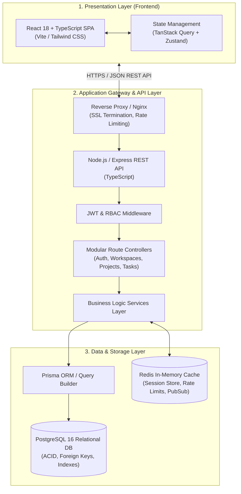
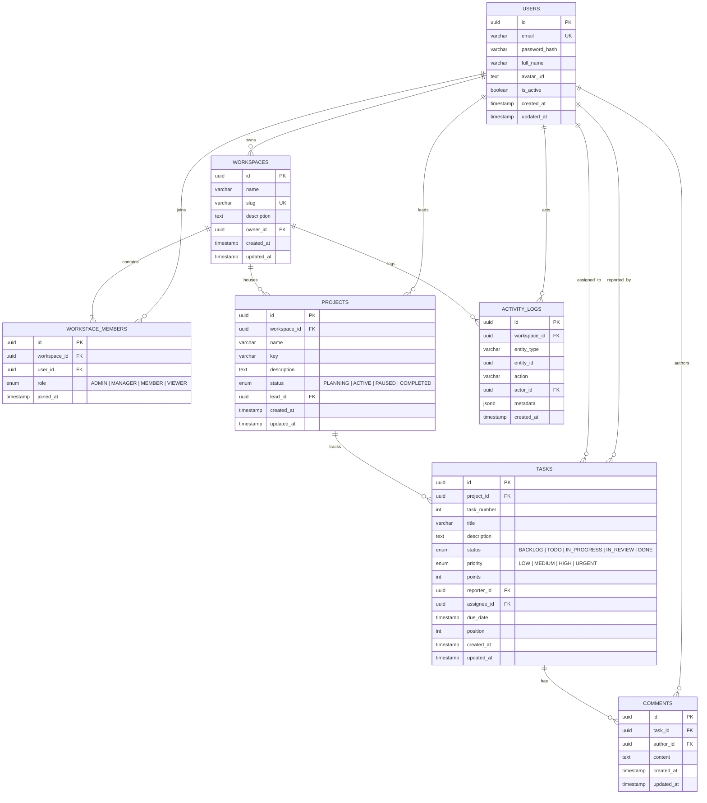
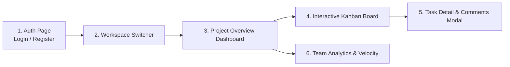
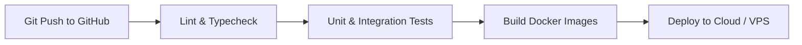

# Software Architecture Specification: TaskFlow

> **Project Name:** TaskFlow - Modern Agile Workflow & Task Management Platform  
> **Author:** Tharun K. (SWYNEX Technologies Internship Program)  
> **Document Version:** 1.0.0  
> **Task:** Task 1 - Project Architecture  
> **Date:** November 2026  

---

## Table of Contents
1. [Executive Summary & Product Idea](#1-executive-summary--product-idea)
2. [System Architecture Overview](#2-system-architecture-overview)
3. [Technology Stack Justification](#3-technology-stack-justification)
4. [Data Models & Entity-Relationship Diagram](#4-data-models--entity-relationship-diagram)
5. [RESTful API Route Specifications](#5-restful-api-route-specifications)
6. [Frontend Screen Architecture & User Flow](#6-frontend-screen-architecture--user-flow)
7. [Security, Performance & Non-Functional Design](#7-security-performance--non-functional-design)
8. [DevOps, Containerization & CI/CD](#8-devops-containerization--cicd)

---

## 1. Executive Summary & Product Idea

### 1.1 Problem Statement
Modern distributed software development teams frequently suffer from tool fragmentation. Developers and product managers oscillate between cumbersome enterprise issue trackers that have steep learning curves and simplistic to-do apps lacking role-based security, sprint metrics, and real-time collaboration.

### 1.2 Proposed Solution: TaskFlow
**TaskFlow** is an agile project management and task orchestration platform designed for speed, clarity, and team alignment. It merges the intuitive simplicity of modern kanban boards with enterprise-grade data isolation, role-based access control (RBAC), and team velocity analytics.

### 1.3 Key Features
- **Multi-Tenant Workspace Hierarchy:** Organizations create secure workspaces containing isolated projects, custom team permissions, and centralized user management.
- **Interactive Agile Kanban Board:** Real-time drag-and-drop task progression across customizable sprint statuses (`BACKLOG`, `TODO`, `IN_PROGRESS`, `IN_REVIEW`, `DONE`).
- **Comprehensive Task Metadata:** Assignees, priority levels (`LOW`, `MEDIUM`, `HIGH`, `URGENT`), story points, due dates, checklists, and rich markdown descriptions.
- **Activity Stream & Comment Threads:** Real-time audit trail and conversational commentary for every issue.
- **Team Velocity Analytics:** Visual metrics on sprint completion rates, workload distribution across engineers, and lead time trends.

---

## 2. System Architecture Overview

TaskFlow follows a modern **three-tier client-server micro-modular architecture** designed for horizontal scalability, high availability, and separation of concerns.



### Architectural Principles Applied
1. **Stateless API Design:** The backend does not store session state in memory; authentication relies on signed, cryptographically verified JSON Web Tokens (JWT). This enables seamless horizontal scaling behind a reverse proxy.
2. **Layered Decoupling:** Controllers handle HTTP transport and validation, Services encapsulate business domain logic, and Prisma/Data Access handles database operations.
3. **Cache-Aside Pattern:** High-frequency, read-heavy endpoints (e.g., project boards and workspace summaries) utilize Redis caching with automated cache invalidation on write events (`POST`/`PATCH`/`DELETE`).

---

## 3. Technology Stack Justification

| Tier | Chosen Technology | Rationale & Trade-offs |
| :--- | :--- | :--- |
| **Frontend** | React 18, TypeScript, Tailwind CSS, Vite | React offers a mature ecosystem and rich component lifecycle. TypeScript guarantees end-to-end type safety matching backend API contracts. Tailwind CSS delivers rapid, uniform utility-first UI styling. |
| **Backend API** | Node.js, Express, TypeScript | Asynchronous, event-driven non-blocking I/O ideal for concurrent API interactions. TypeScript prevents runtime errors and enforces rigorous data structures. |
| **ORM / Data Layer** | Prisma ORM | Provides auto-generated type-safe database queries, automated declarative schema migrations, and superior developer ergonomics over raw SQL while preventing SQL injection. |
| **Primary Database** | PostgreSQL 16 | Relational consistency is non-negotiable for project hierarchies (users, workspaces, projects, tasks, relations). ACID compliance guarantees reliable transaction handling. |
| **Cache & Real-Time** | Redis 7 | Sub-millisecond latency for session validation, API rate limiting, and pub/sub message broadcasting for real-time task board updates. |
| **Containerization** | Docker, Docker Compose | Guarantees identical runtime environments between local development, staging, and production environments. |

---

## 4. Data Models & Entity-Relationship Diagram

### 4.1 Mermaid ER Diagram



### 4.2 Data Entity Schema Breakdown
1. **User (`users`)**: Authenticated identities storing email credentials, display names, profile avatars, and timestamps.
2. **Workspace (`workspaces`)**: Top-level multi-tenant boundary. Enforces data isolation between distinct client teams or organizations.
3. **Workspace Member (`workspace_members`)**: Join table assigning RBAC roles (`ADMIN`, `MANAGER`, `MEMBER`, `VIEWER`) per user within a given workspace.
4. **Project (`projects`)**: High-level initiative containing tasks. Has a short unique identifier key (`key`, e.g., `SWYN`) used as the prefix for ticket numbering (`SWYN-101`).
5. **Task (`tasks`)**: Core operational unit. Tracks status, priority, estimated story points, assignee, reporter, and Kanban column index order.
6. **Comment (`comments`)**: Collaborative discussion threads attached directly to tasks.
7. **Activity Log (`activity_logs`)**: Immutable event audit log capturing who changed what and when.

---

## 5. RESTful API Route Specifications

All endpoints are versioned under `/api/v1` and utilize standard HTTP status codes (`200 OK`, `201 Created`, `400 Bad Request`, `401 Unauthorized`, `403 Forbidden`, `404 Not Found`, `500 Internal Server Error`).

### Standard Response Envelope
```json
{
  "success": true,
  "data": { ... },
  "message": "Operation completed successfully",
  "meta": {
    "page": 1,
    "limit": 20,
    "total": 142
  }
}
```

### Complete Endpoint Registry

#### 5.1 Authentication & User Profile
| Method | Endpoint | Access | Description |
| :--- | :--- | :--- | :--- |
| `POST` | `/api/v1/auth/register` | Public | Register user account with email, password, and name |
| `POST` | `/api/v1/auth/login` | Public | Validate credentials and return JWT bearer token |
| `GET` | `/api/v1/auth/me` | Authenticated | Retrieve current user profile and workspace affiliations |
| `PATCH` | `/api/v1/auth/profile` | Authenticated | Update user display name, avatar, or preferences |

#### 5.2 Workspaces & Memberships
| Method | Endpoint | Access | Description |
| :--- | :--- | :--- | :--- |
| `GET` | `/api/v1/workspaces` | Authenticated | List all workspaces the logged-in user belongs to |
| `POST` | `/api/v1/workspaces` | Authenticated | Create a new organization workspace |
| `GET` | `/api/v1/workspaces/:workspaceId` | Workspace Member | Retrieve workspace details and member list |
| `POST` | `/api/v1/workspaces/:workspaceId/members` | Workspace Admin | Invite a user to the workspace with specified role |
| `DELETE` | `/api/v1/workspaces/:workspaceId/members/:userId` | Workspace Admin | Remove a user from the workspace |

#### 5.3 Projects
| Method | Endpoint | Access | Description |
| :--- | :--- | :--- | :--- |
| `GET` | `/api/v1/workspaces/:workspaceId/projects` | Workspace Member | List all projects within a workspace |
| `POST` | `/api/v1/workspaces/:workspaceId/projects` | Workspace Manager/Admin | Create a new project with unique prefix key |
| `GET` | `/api/v1/projects/:projectId` | Project Member | Get project details, milestone statistics, and members |
| `PATCH` | `/api/v1/projects/:projectId` | Project Manager/Admin | Update project metadata or status |
| `DELETE` | `/api/v1/projects/:projectId` | Workspace Admin | Archive or delete a project |

#### 5.4 Tasks & Kanban Board
| Method | Endpoint | Access | Description |
| :--- | :--- | :--- | :--- |
| `GET` | `/api/v1/projects/:projectId/tasks` | Project Member | Retrieve tasks with status, priority, and assignee filters |
| `POST` | `/api/v1/projects/:projectId/tasks` | Contributor+ | Create a new task under project |
| `GET` | `/api/v1/tasks/:taskId` | Project Member | Retrieve complete task details, comments, and change log |
| `PATCH` | `/api/v1/tasks/:taskId` | Contributor+ | Update task fields (status, priority, points, assignee) |
| `PATCH` | `/api/v1/tasks/:taskId/position` | Contributor+ | Reorder task within Kanban column or transfer column |
| `DELETE` | `/api/v1/tasks/:taskId` | Manager/Admin | Permanently remove a task |

#### 5.5 Comments & Collaboration
| Method | Endpoint | Access | Description |
| :--- | :--- | :--- | :--- |
| `GET` | `/api/v1/tasks/:taskId/comments` | Project Member | Retrieve chronological comments for a task |
| `POST` | `/api/v1/tasks/:taskId/comments` | Contributor+ | Post a new comment to a task |
| `DELETE` | `/api/v1/comments/:commentId` | Author/Admin | Delete a comment |

#### 5.6 Analytics & Reports
| Method | Endpoint | Access | Description |
| :--- | :--- | :--- | :--- |
| `GET` | `/api/v1/analytics/workspaces/:workspaceId/summary` | Workspace Member | Aggregate counts of open/completed tasks and velocity |
| `GET` | `/api/v1/analytics/projects/:projectId/burndown` | Project Member | Return sprint point burndown trajectory |

---

## 6. Frontend Screen Architecture & User Flow

### 6.1 User Navigation Journey



### 6.2 Screen Descriptions & UI Specifications
1. **Screen 1: Authentication & Onboarding (`/auth/login`)**:
   - Modern split-card layout with secure password hashing validation, remember-me token handling, and SSO integration hooks.
2. **Screen 2: Workspace & Project Hub (`/workspaces`)**:
   - Workspace selector dropdown, active sprint summary banner, and cards displaying project health, completion percentage progress bars, and team member badges.
3. **Screen 3: Interactive Agile Kanban Board (`/projects/:projectId/board`)**:
   - Five distinct vertical swimlanes (`BACKLOG`, `TODO`, `IN_PROGRESS`, `IN_REVIEW`, `DONE`).
   - Cards display task key (e.g. `SWYN-104`), priority badge, story points badge, due date status, and assignee avatar.
   - Live filters for quick filtering by assignee, priority, and text search.
4. **Screen 4: Task Detail Modal (`/tasks/:taskId`)**:
   - Modal drawer with full markdown task description, checklist items, attached links, and threaded discussions.
5. **Screen 5: Team Analytics & Sprint Reports (`/analytics`)**:
   - High-level KPI widgets (Sprint Velocity, Open Bugs, Cycle Time) and charts (Burndown trendline and Task distribution by member).

---

## 7. Security, Performance & Non-Functional Design

### 7.1 Security Architecture
- **Stateless Authentication:** JSON Web Tokens (JWT) signed with HMAC-SHA256. Access tokens carry short expiration (15 minutes); refresh tokens stored securely in HTTP-only, `SameSite=Strict` cookies.
- **Password Protection:** Passwords salted and hashed with **bcrypt** (12 work factor rounds). Raw passwords never logged or transmitted in plain text.
- **Role-Based Access Control (RBAC):** Middleware validates hierarchical user permissions (`ADMIN` > `MANAGER` > `MEMBER` > `VIEWER`) prior to executing sensitive mutations.
- **Defense-in-Depth:**
  - `helmet` middleware sets secure HTTP headers (XSS Filter, HSTS, Frameguard).
  - `cors` whitelist restricts API consumption strictly to authorized frontend origins.
  - Rate limiting via `express-rate-limit` prevents brute-force credential stuffing and DDoS attacks.
  - Strict input sanitization and schema validation using **Zod**.

### 7.2 Performance & Scalability
- **Database Indexing:** Compound indexes on foreign keys (`workspace_id`, `project_id`) and high-cardinality query columns (`tasks(project_id, status)`).
- **In-Memory Caching:** Redis caches frequent workspace membership lookups and project board state.
- **Optimistic UI Updates:** The frontend updates board state instantaneously upon drag-and-drop, reverting cleanly if the backend network call fails.

---

## 8. DevOps, Containerization & CI/CD

### 8.1 Docker Architecture
TaskFlow delivers a self-contained multi-container `docker-compose.yml` orchestrating:
- `taskflow_postgres`: PostgreSQL database with automated startup schema initialization.
- `taskflow_redis`: In-memory caching and message bus.
- `taskflow_backend`: Node.js Express server running in a hardened Node Alpine container.
- `taskflow_frontend`: Production build of the React SPA served via Nginx.

### 8.2 Automated CI/CD Pipeline Flow

- **Continuous Integration:** GitHub Actions executes ESLint, Prettier, TypeScript checks (`tsc --noEmit`), and Jest API tests on every pull request.
- **Continuous Deployment:** On merge to `main`, Docker images are packaged and deployed seamlessly.

---

*Authored for SWYNEX Technologies Internship Program - Task 1.*
