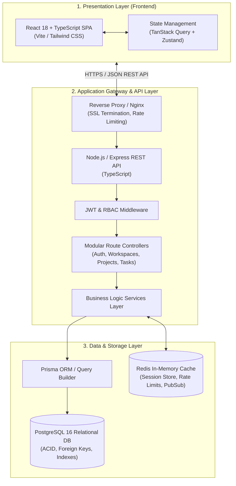
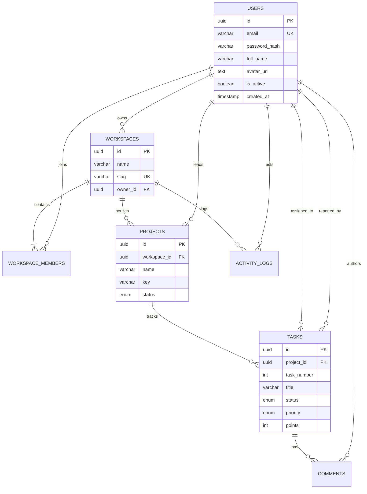

# SWYNEX-Project-Architecture

[](https://swynex.tech)
[](https://opensource.org/licenses/MIT)
[](https://www.typescriptlang.org/)
[](https://www.postgresql.org/)
[](https://www.docker.com/)

> **Task 1 Submission: Full-Stack Application Architecture**  
> **Internship Track:** Full-Stack Web Development / Software Engineering  
> **Company:** SWYNEX Technologies  
> **Author:** Tharun M.  

---

## 🌟 Executive Summary

**TaskFlow** is a modern, collaborative Agile Project & Task Management Platform designed for engineering teams and agile squads. It combines the intuitive interaction of real-time Kanban sprint boards with enterprise-grade data isolation, role-based access control (RBAC), and team velocity analytics.

This repository contains the complete architectural specifications, relational data models (PostgreSQL + Prisma), RESTful API route definitions (Node.js/Express + TypeScript), interactive frontend wireframes (React + Tailwind CSS), and multi-container Docker deployment configs.

---

## 📐 Architecture Documentation Links

| Document | Purpose |
| :--- | :--- |
| 📄 [**ARCHITECTURE.md**](./ARCHITECTURE.md) | **Primary Architecture Specification**: System design, data models, API specs, security, and non-functional requirements. |
| 🗄️ [**docs/schema.sql**](./docs/schema.sql) | Production PostgreSQL DDL database schema with foreign keys and indexes. |
| 📡 [**docs/api-spec.json**](./docs/api-spec.json) | OpenAPI 3.0 REST API schema specification. |
| 🖼️ [**docs/wireframes.md**](./docs/wireframes.md) | Frontend screen layouts, component hierarchy, and user journeys. |
| 🐳 [**docker-compose.yml**](./docker-compose.yml) | Multi-container orchestration (PostgreSQL, Redis, Backend, Frontend). |
| 🚀 [**TASK_1_SUBMISSION_GUIDE.md**](./TASK_1_SUBMISSION_GUIDE.md) | GitHub push commands, LinkedIn post template, and video explanation script. |

---

## 🏗️ High-Level System Architecture



---

## 🗃️ Relational Entity-Relationship Diagram (ERD)



---

## 🚀 Quick Start & Local Setup

### Option 1: Run with Docker Compose (Recommended)
Clone the repository and run all services (Database, Redis, API, and Frontend) in a single command:

```bash
# Clone the repository
git clone https://github.com/Catdas/SWYNEX-Project-Architecture.git
cd SWYNEX-Project-Architecture

# Start all containers
docker-compose up --build
```
- **Frontend Web UI:** `http://localhost:5173`
- **Backend API:** `http://localhost:5000`
- **Healthcheck:** `http://localhost:5000/health`

---

### Option 2: Run Locally (Bare Metal)

#### Backend Setup:
```bash
cd backend
npm install
npm run build
npm start
```

#### Frontend Setup:
```bash
cd frontend
npm install
npm run dev
```

---

## 📂 Repository Structure

```
SWYNEX-Project-Architecture/
├── .env.example                       # Sample environment variables
├── .gitignore                         # Standard git ignore definitions
├── docker-compose.yml                 # Multi-container local orchestration
├── README.md                          # Project overview & quickstart
├── ARCHITECTURE.md                    # Core architecture design specification
├── TASK_1_SUBMISSION_GUIDE.md         # Submission links & LinkedIn post kit
├── docs/                              # Supplementary architecture artifacts
│   ├── api-spec.json                  # OpenAPI 3.0 REST route definitions
│   ├── schema.sql                     # Raw PostgreSQL DDL table definitions
│   └── wireframes.md                  # Screen-by-screen layouts & specs
├── backend/                           # Node.js + Express + TypeScript service
│   ├── Dockerfile
│   ├── package.json
│   ├── tsconfig.json
│   ├── prisma/
│   │   └── schema.prisma              # Prisma ORM schema
│   └── src/
│       ├── config/                    # Config & environment variables
│       ├── controllers/               # API endpoint business logic
│       ├── middlewares/               # JWT authentication & error handlers
│       ├── routes/                    # Modular Express routes
│       └── server.ts                  # Server entry point
└── frontend/                          # React + TypeScript + Tailwind CSS client
    ├── Dockerfile
    ├── package.json
    ├── tsconfig.json
    ├── vite.config.ts
    ├── index.html
    └── src/
        ├── components/                # Navbar, Sidebar, KanbanBoard, TaskCard
        ├── pages/                     # Dashboard, Board, Analytics, Login
        ├── services/                  # API data clients & mock data
        ├── types/                     # Shared TypeScript data contracts
        ├── App.tsx                    # Main App router
        └── main.tsx                   # React root entry
```

---

## 🔒 Security & Best Practices
- **Authentication:** Stateless signed JSON Web Tokens (JWT) with HTTP-only refresh tokens.
- **Password Security:** Salted hashing with `bcrypt` (work factor 12).
- **Network Hardening:** `helmet` security headers, strict `cors` whitelist, and IP rate limiting with `express-rate-limit`.
- **Validation:** Strict schema enforcement via `zod` to prevent malformed payloads and injection attacks.

---

## 📝 Internship Submission Details
- **Program:** SWYNEX Technologies Internship Program
- **Task:** Task 1 - Project Architecture
- **Repository Name:** `SWYNEX-Project-Architecture`
